# CarbonGate: Carbon-Aware Quality Gates for Kubernetes GitOps

[](https://opensource.org/licenses/Apache-2.0)
[](https://kubernetes.io/)
[](https://www.python.org/)
[](https://doi.org/10.5281/zenodo.23970103)

Carbon-intensity admission gates and a preregistered Great Britain grid simulation for Kubernetes GitOps delivery pipelines (Argo CD, Flux, and Tekton).



Interactive HTML version: [`docs/diagrams/carbongate-gitops-flow.html`](./docs/diagrams/carbongate-gitops-flow.html)

<!-- v2-release -->
## Version 2.0 study (November 2026)

Version 2.0 is a preregistered, reproducible rewrite of the paper:
*Carbon-Aware GitOps Gates Revisited: A Preregistered Trace-Driven Evaluation of CarbonGate on Great Britain Grid Data*.

- Paper, simulation code, cached NESO grid series, results, and tests: [`v2/`](v2/)
- Zenodo archive: [10.5281/zenodo.23970103](https://doi.org/10.5281/zenodo.23970103) (replaces v1 [10.5281/zenodo.18527247](https://doi.org/10.5281/zenodo.18527247))
- Preregistered verdicts (`v2/results/verdict.json`): `H1` (`>= 5%` reduction under a 4 h SLA) is `INCONCLUSIVE` at 4.80% mean reduction (95% CI 4.17% to 5.43% across 11 held-out months x 5 seeds, 0 SLA violations); `H2_v1_claim` (`>= 23%`) is `REFUTED`
- Reproduce every figure and table from raw data: `python v2/code/run_all.py`

Unsupported v1 claims were audited and removed; [`v2/REVIEW.md`](v2/REVIEW.md) documents each change.
<!-- v2-release -->

## How the gate works

When Argo CD, Flux, or Tekton starts a sync, CarbonGate checks whether the deployment carries an urgent or hotfix override. Urgent changes roll out right away. Standard deployments query the grid carbon-intensity forecast across the remaining SLA window (for example 4 hours on 30-minute NESO slots, or WattTime and Electricity Maps where configured).

If a future slot inside the SLA window is cleaner than the current slot by at least `delta` (default 5%), CarbonGate defers the sync to the lowest-intensity slot. If the current slot is already the cleanest option, or the forecast endpoint times out under a `fail_open` or `cached_persistence` fallback, the sync proceeds immediately.

## CLI and library usage

`src/carbongate/` contains the Python gate package and CLI (`carbongate`), while `v2/code/carbongate/` holds the pure decision rule (`decide()`) and trace simulator used in the v2 paper.

```bash
git clone https://github.com/bhavinkotak/carbongate.git
cd carbongate

python3 -m venv .venv
source .venv/bin/activate
pip install -e ".[dev]"

# Run package unit tests and v2 study tests
pytest tests/ v2/tests/ -v

# Check a deployment from the CLI
carbongate check --deployment my-app --cpu 4 --memory 8 --priority normal
```

## Example policy configuration

```yaml
apiVersion: carbongate.io/v1
kind: CarbonPolicy
metadata:
  name: default-policy
  namespace: carbongate-system
spec:
  thresholds:
    green: 150      # g CO2/kWh: proceed immediately
    yellow: 300     # g CO2/kWh: proceed with warning
    red: 450        # g CO2/kWh: defer within SLA or require approval

  actions:
    green: proceed
    yellow: proceed-with-warning
    red: defer-or-approve

  overrides:
    - priority: critical
      action: always-proceed
    - namespace: production-hotfix
      action: always-proceed

  deferral:
    maxWaitTime: 4h
    checkInterval: 15m
    forecastHorizon: 24h
```

## GitOps hook examples

### Argo CD PreSync job

```yaml
apiVersion: batch/v1
kind: Job
metadata:
  name: carbongate-presync
  annotations:
    argocd.argoproj.io/hook: PreSync
    argocd.argoproj.io/hook-delete-policy: HookSucceeded
spec:
  template:
    spec:
      containers:
      - name: carbongate
        image: carbongate/gate:v1.0
        env:
        - name: CARBON_POLICY
          value: "default-policy"
      restartPolicy: Never
```

### Flux webhook receiver

```yaml
apiVersion: notification.toolkit.fluxcd.io/v1
kind: Receiver
metadata:
  name: carbongate-receiver
spec:
  type: generic
  secretRef:
    name: carbongate-webhook-token
  resources:
    - kind: Kustomization
      name: "*"
```

### Tekton task

```yaml
apiVersion: tekton.dev/v1beta1
kind: Task
metadata:
  name: carbongate-check
spec:
  steps:
  - name: carbon-gate
    image: carbongate/gate:v1.0
    script: |
      carbongate check --policy=default-policy
```

## Carbon estimation formula

`src/carbongate/estimator.py` models transient deployment energy as `C_deploy = E_compute * PUE * I_carbon * T_duration`, using default assumptions of 10 W per active core, 3 W per idle core, 0.375 W per GB of memory, 0.5 W per Gbps of network, and 0.01 W per MB/s of storage I/O. As shown in `v2/`, relative intensity reduction for homogeneous rollout durations is invariant to the linear energy scale factor.

## Preregistered evaluation summary (v2.0)

Evaluated on 12 months of Great Britain NESO half-hourly carbon-intensity forecasts and actuals (1 calibration month, 11 held-out months, 5 workload seeds, 10% urgent bypass share):

| Policy / test | Result | Notes |
|---|---|---|
| `CarbonGate-F` (4 h SLA, NESO forecast) | 4.80% mean reduction | 95% CI [4.17%, 5.43%]; 0.369 kg saved of 7.52 kg CO2 per seed; 0 SLA misses |
| `H1` (`>= 5%` mean reduction at 4 h SLA) | `INCONCLUSIVE` | CI straddles the preregistered 5% boundary |
| `H2` (v1 claim of `>= 23%` reduction) | `REFUTED` | Measured savings sit near 5%, shifting rollout transients only |
| Static threshold gate (v1 rule, 2 h and 4 h) | `<= 0%` reduction | Waiting for a fixed threshold often expires at a dirtier deadline slot |
| Outage fallbacks (`fail_open`, `cached_persistence`) | 0 SLA violations | `fail_closed` violates SLAs during extended forecast outages |

## Repository layout

```text
carbongate/
├── docs/diagrams/          Editorial admission flow (.html + .svg)
├── src/carbongate/         Python package: estimator, gate controller, and CLI
├── tests/                  Unit tests for estimator and gate controller
├── v2/
│   ├── REVIEW.md           Audit of v1 claims and v2 methodology fixes
│   ├── preregistration.json Locked hypotheses and falsifiers
│   ├── code/               NESO downloader, pure gate rule, simulator, figure/table builders
│   ├── data/               Cached Great Britain national/regional JSON.gz + SHA-256 manifest
│   ├── paper/              LaTeX manuscript and compiled PDF
│   ├── results/            Generated CSVs and JSON summaries (verdict.json)
│   └── tests/              24 pytest checks for gate rules, outages, and simulator invariants
├── CITATION.cff
└── pyproject.toml
```

## Citation

```bibtex
@misc{kotak2026carbongate_v2,
  title  = {Carbon-Aware GitOps Gates Revisited: A Preregistered Trace-Driven Evaluation of CarbonGate on Great Britain Grid Data},
  author = {Kotak, Bhavin},
  year   = {2026},
  doi    = {10.5281/zenodo.23970103},
  url    = {https://doi.org/10.5281/zenodo.23970103}
}
```

## License and author

Licensed under Apache 2.0; see [LICENSE](LICENSE).

Bhavin Kotak (bhavin.kotak@ibm.com), ORCID [0009-0006-4793-7046](https://orcid.org/0009-0006-4793-7046).
